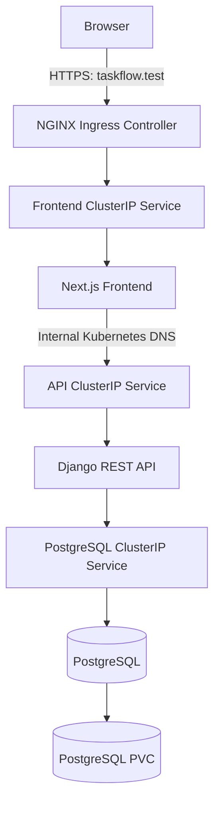
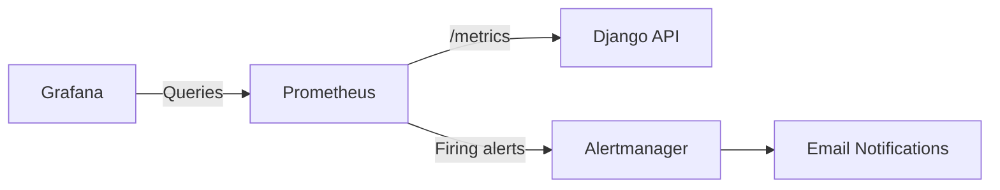

# TaskFlow — Kubernetes Production Platform

A full-stack, containerized task management platform deployed on Kubernetes. This project demonstrates cloud-native application architecture, Kubernetes orchestration, persistent storage, HTTPS ingress, observability, container security, and automated CI/CD.

TaskFlow combines a **Django REST API**, a **Next.js frontend**, and **PostgreSQL**, with Prometheus, Grafana, and Alertmanager providing monitoring and alerting.

The application runs on a local Minikube cluster and is exposed through NGINX Ingress using HTTPS.

**Repository:** [Daniel-Chacha/kubernetes-production-platform](https://github.com/Daniel-Chacha/kubernetes-production-platform)

---

## Table of Contents

- [Overview](#overview)
- [Architecture](#architecture)
- [Technology Stack](#technology-stack)
- [Features](#features)
- [Monitoring and Observability](#monitoring-and-observability)
- [Security](#security)
- [CI/CD Pipeline](#cicd-pipeline)
- [Project Structure](#project-structure)
- [Prerequisites](#prerequisites)
- [Accessing the Application](#accessing-the-application)
- [Kubernetes Operations](#kubernetes-operations)
- [API and Database](#api-and-database)
- [Documentation](#documentation)
- [Current Limitations](#current-limitations)
- [Future Improvements](#future-improvements)
- [Author](#author)

---

## Overview

TaskFlow is a practical Kubernetes platform engineering project built around a working task management application.

The frontend and backend are independently containerized and deployed as Kubernetes workloads. Kubernetes Services provide stable internal networking, while NGINX Ingress handles external application access.

The project goes beyond basic container orchestration by incorporating:

- PostgreSQL with persistent Kubernetes storage.
- Kubernetes Deployments, Services, ConfigMaps, and Secrets.
- NGINX Ingress with locally trusted HTTPS.
- Readiness and liveness probes.
- CPU and memory resource requests and limits.
- Prometheus metrics collection.
- Grafana dashboards.
- Alertmanager email notifications.
- Trivy container vulnerability scanning.
- GitHub Actions CI/CD.
- Deployment failure handling using previously deployed image references.
- Non-root containers and restricted Linux capabilities.

The current deployment target is a local Minikube environment. It is a portfolio project demonstrating production-oriented Kubernetes practices, not a highly available production service.

## Architecture

### High-level architecture



### Request flow

1. A user opens `https://taskflow.test`.
2. NGINX Ingress receives the HTTPS request and terminates TLS.
3. Ingress routes traffic to the frontend Kubernetes Service.
4. The Next.js application serves the dashboard.
5. Frontend API requests are proxied to the Django API using its internal Kubernetes DNS name.
6. The Django API processes requests and communicates with PostgreSQL.
7. PostgreSQL stores application data on persistent storage.

### Monitoring architecture



Application workloads run in the `portfolio` namespace. Monitoring components run in the `monitoring` namespace.

## Technology Stack

| Layer | Technologies |
|---|---|
| Frontend | Next.js, React, TypeScript |
| Backend | Python, Django |
| Database | PostgreSQL |
| Containerization | Docker |
| Container registry | GitHub Container Registry (GHCR) |
| Orchestration | Kubernetes |
| Local cluster | Minikube |
| Ingress | NGINX Ingress Controller |
| TLS | mkcert, Kubernetes TLS Secret |
| Metrics collection | Prometheus |
| Dashboards | Grafana |
| Alerting | Alertmanager |
| Vulnerability scanning | Trivy |
| CI/CD | GitHub Actions |
| Deployment runner | Self-hosted Linux x64 runner |

## Features

### Task management application

- User authentication.
- Task creation and management.
- View all tasks.
- Filter tasks by pending and completed status.
- Dashboard interface with task information and status.

### Django REST API

- REST endpoints for task management.
- Authentication endpoints.
- Health endpoint for application health checks.
- Prometheus metrics endpoint.
- PostgreSQL integration.
- Environment-based configuration.

### Kubernetes deployment

- Separate frontend, backend, and database workloads.
- ClusterIP Services for internal service discovery.
- NGINX Ingress for application routing.
- HTTPS access using a Kubernetes TLS Secret.
- PersistentVolumeClaims for database and monitoring data.
- ConfigMaps and Secrets for application configuration.
- Readiness and liveness probes.
- CPU and memory resource requests and limits.

### Observability

- Prometheus metrics collection.
- Grafana dashboard for TaskFlow API observability.
- Alertmanager for alert routing and email notifications.
- Alerts for API availability, high HTTP 5xx rates, and elevated request latency.
- Persistent Prometheus, Grafana, and Alertmanager storage.

## Monitoring and Observability

The monitoring stack is deployed separately in the `monitoring` namespace.

| Component | Purpose |
|---|---|
| Prometheus | Scrapes and stores application metrics |
| Grafana | Visualizes application and infrastructure metrics |
| Alertmanager | Groups and routes firing alerts |

The TaskFlow API exposes metrics through `/metrics`.

The monitoring configuration includes visibility into:

- API request rates.
- HTTP response status codes.
- Request latency, including p95 latency.
- HTTP 5xx responses.
- API process memory and CPU.
- Prometheus scrape health.

Configured alerts include:

| Alert | Condition | Severity |
|---|---|---|
| `TaskAPIUnavailable` | API scrape unavailable or target absent | Critical |
| `TaskAPIHigh5xxRate` | HTTP 5xx rate exceeds configured threshold | Warning |
| `TaskAPIHighLatency` | p95 request latency exceeds configured threshold | Warning |

Alertmanager is configured to send email notifications through SMTP. SMTP credentials are supplied using a Kubernetes Secret.

Prometheus data retention is configured for seven days.

See [Monitoring and Observability](docs/monitoring-and-observability.md) for configuration and access instructions.

## Security

Security practices implemented in the project include:

- Non-root application containers.
- Restricted Linux capabilities.
- Disabled privilege escalation.
- Kubernetes Secrets for sensitive application configuration.
- Separation of configuration and credentials using ConfigMaps and Secrets.
- HTTPS through NGINX Ingress.
- Trivy vulnerability scanning during CI.
- Commit-SHA image tags for deployment traceability.
- Disabled automatic service account token mounting where configured.

Trivy is configured to scan operating system packages and application libraries for HIGH and CRITICAL vulnerabilities, with unfixed vulnerabilities ignored by the configured scan.

NetworkPolicies are not enforced in the current cluster configuration.

## CI/CD Pipeline

GitHub Actions automates application validation, image builds, vulnerability scanning, image publication, and deployment.

### Continuous Integration

The CI workflow performs:

1. Django dependency installation, checks, and tests.
2. Frontend dependency installation, linting, and production build.
3. Docker image builds using Docker Buildx.
4. Trivy vulnerability scanning.
5. Image publication to GHCR after successful pushes to `master`.

The backend CI environment uses SQLite for automated checks and tests. The deployed Kubernetes application uses PostgreSQL.

### Continuous Deployment

The deployment workflow:

1. Runs after successful CI on `master`, or through manual workflow dispatch.
2. Uses a self-hosted Linux x64 runner with Kubernetes access.
3. Verifies the Kubernetes context and required resources.
4. Records the previously deployed API and frontend image references.
5. Updates the Deployments to use commit-SHA image tags.
6. Waits for Kubernetes rollouts.
7. Verifies application availability over HTTPS.
8. Attempts to restore the previous image references if deployment or health verification fails.

The deployment recovery mechanism restores application image references. It does not automatically reverse database schema changes or restore database data.

Workflow definitions:

- `.github/workflows/ci.yml`
- `.github/workflows/deploy.yml`

See [CI/CD Documentation](docs/ci-cd.md) for more details.

## Project Structure

```text
kubernetes-production-platform/
├── app/                              # Django backend
│   ├── config/                       # Django configuration
│   ├── tasks/                        # Task and authentication logic
│   ├── Dockerfile
│   ├── manage.py
│   └── requirements.txt
│
├── tasks-mngt-frontend/              # Next.js frontend
│   ├── app/                          # Application pages and styles
│   ├── lib/                          # API and authentication helpers
│   ├── Dockerfile
│   └── package.json
│
├── k8s/                              # Kubernetes manifests
│   ├── namespace.yaml
│   ├── configmap.yaml
│   ├── deployment.yaml
│   ├── frontend-deployment.yaml
│   ├── service.yaml
│   ├── ingress.yaml
│   ├── postgres-deployment.yaml
│   ├── postgres-service.yaml
│   ├── postgres-pvc.yaml
│   └── monitoring/
│       ├── alert-rules.yaml
│       ├── prometheus-configmap.yaml
│       ├── prometheus-deployment.yaml
│       ├── prometheus-pvc.yaml
│       ├── prometheus-rules-configmap.yaml
│       └── prometheus-svc.yaml
│
├── scripts/                          # Operational scripts
│   └── import_tasks_to_postgres.py
│
├── docs/                             # Project documentation
│   ├── architecture.md
│   ├── deployment.md
│   ├── monitoring-and-observability.md
│   ├── operations-runbook.md
│   └── ci-cd.md
│
├── .github/
│   └── workflows/
│       ├── ci.yml
│       └── deploy.yml
│
├── .gitignore
└── README.md
```

## Prerequisites

To work with the project locally, install:

- [Git](https://git-scm.com/)
- [Docker](https://docs.docker.com/get-docker/)
- [Minikube](https://minikube.sigs.k8s.io/docs/start/)
- [kubectl](https://kubernetes.io/docs/tasks/tools/)
- [mkcert](https://github.com/FiloSottile/mkcert)
- Python and pip for local backend development.
- Node.js and npm for local frontend development.

The Docker daemon must be running before starting Minikube with the Docker driver.

## Accessing the Application

The configured local application hostname is:

```text
https://taskflow.test
```

The hostname must resolve to the Minikube IP address.

Check the current Minikube IP:

```bash
minikube ip
```

The local `/etc/hosts` file should contain an entry mapping that IP to `taskflow.test`:

```text
<MINIKUBE_IP> taskflow.test
```

Replace `<MINIKUBE_IP>` with the actual Minikube IP.

The local TLS certificate is generated using mkcert, and its certificate authority must be trusted by the local machine.

Verify application access:

```bash
curl -I https://taskflow.test
```

For detailed deployment instructions, see the [Deployment Guide](docs/deployment.md).

## Kubernetes Operations

The following commands are useful when inspecting the application.

Check application workloads:

```bash
kubectl get pods -n portfolio
kubectl get deployments -n portfolio
kubectl get services -n portfolio
kubectl get ingress -n portfolio
```

Check persistent storage:

```bash
kubectl get pvc -n portfolio
kubectl get pv
```

Inspect application logs:

```bash
kubectl logs deployment/task-api -n portfolio
kubectl logs deployment/task-frontend -n portfolio
kubectl logs deployment/task-postgres -n portfolio
```

Check resource utilization:

```bash
kubectl top nodes
kubectl top pods -A
```

For incident investigation and recovery procedures, see the [Operations Runbook](docs/operations-runbook.md).

## API and Database

The backend is a Django REST API. The frontend communicates with it through the internal Kubernetes Service.

The deployed application uses PostgreSQL.

The database connection is configured through Kubernetes ConfigMaps and Secrets. The database Service is named `task-postgres` and listens on port `5432`.

PostgreSQL data is stored using the `task-postgres-data` PersistentVolumeClaim.

The backend CI workflow uses SQLite for its automated checks and tests; this does not represent the deployed database configuration.

## Documentation

Detailed project documentation is available in the `docs/` directory.

| Document | Description |
|---|---|
| [Architecture](docs/architecture.md) | System architecture, request flow, Kubernetes resources, and security design |
| [Deployment Guide](docs/deployment.md) | Minikube deployment, configuration, ingress, HTTPS, and verification |
| [Monitoring and Observability](docs/monitoring-and-observability.md) | Prometheus, Grafana, Alertmanager, metrics, and alerts |
| [Operations Runbook](docs/operations-runbook.md) | Health checks, troubleshooting, and operational procedures |
| [CI/CD](docs/ci-cd.md) | GitHub Actions, Docker builds, Trivy, GHCR, and Kubernetes deployment |

## Current Limitations

The project deliberately documents the boundaries of the current environment:

- Deployment targets a local Minikube cluster rather than a managed, highly available Kubernetes platform.
- NetworkPolicies are not enforced in the current cluster configuration.
- Automated database backup and restore procedures are not implemented.
- The deployment workflow depends on a self-hosted runner with access to the local Kubernetes environment.
- Application image recovery does not provide database rollback.
- The environment does not have a formal production availability guarantee.

PersistentVolumeClaims should not be deleted during routine troubleshooting because they may contain application or monitoring data.

## Future Improvements

Potential extensions include:

- Deploying to a managed Kubernetes platform.
- Introducing a policy-capable CNI such as Calico or Cilium and enforcing NetworkPolicies.
- Implementing automated PostgreSQL backup and restore.
- Adding database migration management to the deployment process.
- Expanding monitoring to include Kubernetes infrastructure metrics.
- Introducing GitOps-based deployment management.
- Adding centralized log aggregation.
- Implementing more comprehensive integration and end-to-end tests.

## Author

Daniel Chacha

GitHub: [Daniel-Chacha](https://github.com/Daniel-Chacha)

Built as a hands-on Kubernetes, DevOps, and platform engineering portfolio project.
