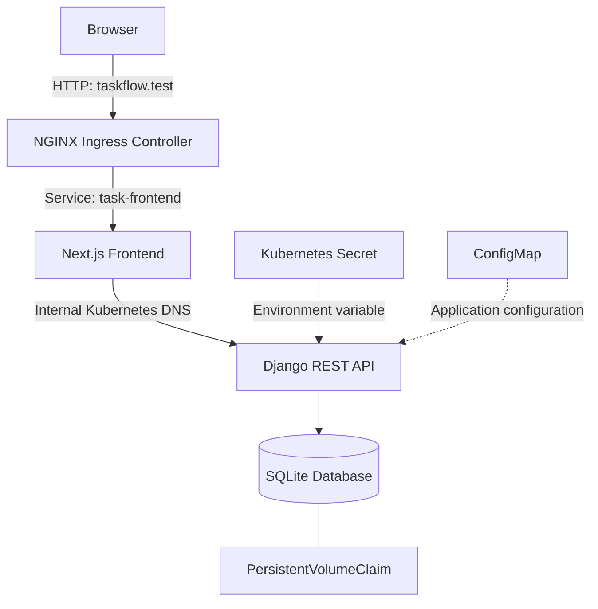

# Taskflow — Kubernetes Production Platform

A containerized, full-stack task management application deployed on Kubernetes, demonstrating cloud-native application architecture, service discovery, ingress routing, persistent storage, health monitoring, and security-conscious deployment practices.

The project combines a **Django REST API** with a **Next.js dashboard**, packaged as separate Docker images and deployed as Kubernetes workloads. The local environment runs on Minikube, with NGINX Ingress routing browser traffic through a custom development hostname.

## Table of Contents

- [Overview](#overview)
- [Architecture](#architecture)
- [Technology Stack](#technology-stack)
- [Features](#features)
- [Project Structure](#project-structure)
- [Prerequisites](#prerequisites)
- [Local Development and Deployment](#local-development-and-deployment)
- [Access the Application](#access-the-application)
- [Kubernetes Operations](#kubernetes-operations)
- [API Endpoints](#api-endpoints)
- [Security and Reliability](#security-and-reliability)
- [Current Limitations](#current-limitations)
- [Roadmap](#roadmap)
- [Author](#author)

## Overview

Taskflow is a full-stack application built to explore how web applications are containerized, deployed, and operated using Kubernetes.

Rather than running the frontend and backend as a single application, each component runs in its own container and is managed through Kubernetes Deployments and Services.

The project emphasizes practical DevOps and platform engineering concepts:

- Containerizing applications with Docker.
- Deploying and managing workloads with Kubernetes.
- Discovering internal services through Kubernetes DNS.
- Routing HTTP traffic through NGINX Ingress.
- Persisting application data using PersistentVolumeClaims.
- Configuring health probes and resource requests and limits.
- Managing application secrets with Kubernetes Secrets.
- Running containers with non-root users and restricted capabilities.

The initial deployment targets a local Kubernetes cluster. The architecture provides a foundation for extending the application toward a production cloud environment.

## Architecture



### Request flow

1. A user opens `http://taskflow.test` in a browser.
2. The NGINX Ingress Controller receives the HTTP request.
3. The Ingress routes traffic to the `task-frontend` Kubernetes Service.
4. The Next.js application serves the dashboard.
5. Frontend API requests are proxied to the Django API through the internal Kubernetes Service DNS name.
6. Django processes task requests and reads or writes data to SQLite.
7. The database file is stored on a mounted persistent volume.

The frontend and backend are independently containerized and deployed, while Kubernetes Services provide stable internal network endpoints.

## Technology Stack

| Layer | Technologies |
|---|---|
| Frontend | Next.js, React, TypeScript |
| Backend | Python, Django, Django REST endpoints |
| Database | SQLite |
| Containerization | Docker |
| Orchestration | Kubernetes |
| Local cluster | Minikube |
| Ingress | NGINX Ingress Controller |
| Configuration | Kubernetes ConfigMaps and Secrets |
| Storage | PersistentVolumeClaim |
| Health monitoring | Kubernetes readiness and liveness probes |
| Development environment | Linux, Kali Linux |

## Features

### Task management dashboard

- View tasks retrieved from the backend API.
- Create tasks through the dashboard.
- Filter tasks by all, pending, and completed states.
- Display task counts and application feedback.
- Handle loading, success, and error states.

### Django REST API

- Expose a health endpoint for Kubernetes probes.
- Retrieve and create tasks through HTTP endpoints.
- Store task data in SQLite.
- Use environment-based configuration for application settings.

### Containerized deployment

- Build independent Docker images for the frontend and backend.
- Run the applications as Kubernetes Deployments.
- Expose each application through a ClusterIP Service.
- Configure frontend-to-backend communication using Kubernetes DNS.

### Kubernetes networking

- Route browser traffic through NGINX Ingress.
- Use the `taskflow.test` development hostname.
- Keep the backend accessible through its internal Kubernetes Service rather than requiring a separate public endpoint.

### Reliability and resource management

- Configure readiness and liveness probes.
- Define CPU and memory requests and limits.
- Persist the backend database using a PersistentVolumeClaim.
- Configure application secrets through Kubernetes Secrets.

## Project Structure

```text
kubernetes-production-platform/
├── app/                          # Django backend
│   ├── config/                   # Django project configuration
│   ├── tasks/                    # Task management application
│   └── manage.py
├── k8s/                          # Kubernetes manifests
│   ├── ingress.yaml
│   ├── frontend-deployment.yaml
│   └── ...                       # Additional deployment/configuration files
├── tasks-mngt-frontend/          # Next.js frontend
│   ├── app/                      # App Router pages and styles
│   ├── public/
│   ├── Dockerfile
│   ├── next.config.ts
│   └── package.json
├── .gitignore
└── README.md
```

The exact manifest filenames may evolve as deployment configuration expands.

## Prerequisites

Install the following tools on your development machine:

- [Git](https://git-scm.com/)
- [Docker](https://docs.docker.com/get-docker/)
- [kubectl](https://kubernetes.io/docs/tasks/tools/)
- [Minikube](https://minikube.sigs.k8s.io/docs/start/)
- [Node.js](https://nodejs.org/) and npm for local frontend development
- Python and pip for local backend development

The Docker daemon must be running, and the machine must have enough CPU and memory to run the local Kubernetes cluster.

## Local Development and Deployment

### 1. Clone the repository

```bash
git clone https://github.com/Daniel-Chacha/kubernetes-production-platform.git
cd kubernetes-production-platform
```


### 2. Start Minikube

Start a local Kubernetes cluster using Docker as the driver:

```bash
minikube start --driver=docker --cpus=2 --memory=3072
```

Enable the required addons:

```bash
minikube addons enable metrics-server
minikube addons enable ingress
```

Verify the cluster:

```bash
kubectl get nodes
kubectl get pods -n ingress-nginx
```

Wait for the Ingress Controller to become ready before testing ingress routing.

### 3. Build the Django backend image

Build the backend image using the Dockerfile in the backend application directory. If your Dockerfile is located at `app/Dockerfile`, run:

```bash
eval "$(minikube docker-env)"

docker build -t task-api:1.0 ./app
```

If your Dockerfile is located elsewhere, adjust the build context to match the repository.

### 4. Build the Next.js frontend image

```bash
cd tasks-mngt-frontend

eval "$(minikube docker-env)"

docker build \
  --build-arg API_INTERNAL_URL=http://task-api.portfolio.svc.cluster.local \
  -t task-frontend:1.0 .

cd ..
```

The frontend uses the Kubernetes Service DNS name to reach the backend. The internal API URL is configured during the frontend build because the Next.js rewrite destination is part of the generated application configuration.

### 5. Deploy the application

Create the namespace if it does not already exist:

```bash
kubectl create namespace portfolio \
  --dry-run=client -o yaml | kubectl apply -f -
```

Apply the Kubernetes manifests from the repository. If the manifests are stored directly in `k8s/`, use:

```bash
kubectl apply -f k8s/
```

**Configuration note:** The backend Deployment references a Kubernetes Secret named `task-api-secret`, a ConfigMap named `task-api-config`, and a PersistentVolumeClaim named `task-api-data`. Ensure these resources are created with appropriate values before deploying the backend. Do not commit actual secret values to Git.

If your manifests use a different namespace or depend on a particular application order, follow those definitions.

### 6. Verify the deployment

```bash
kubectl get all -n portfolio
kubectl get ingress -n portfolio
kubectl get pvc -n portfolio
kubectl rollout status deployment/task-api -n portfolio
kubectl rollout status deployment/task-frontend -n portfolio
```

Check pod logs if a workload fails to start:

```bash
kubectl logs deployment/task-api -n portfolio
kubectl logs deployment/task-frontend -n portfolio
```

## Access the Application

Get the Minikube IP:

```bash
minikube ip
```

Add the IP and hostname to `/etc/hosts`:

```text
MINIKUBE_IP taskflow.test
```

Replace `MINIKUBE_IP` with the actual output of `minikube ip`. Editing `/etc/hosts` requires administrator privileges.

Open the application:

**http://taskflow.test**

This hostname is for local development on a machine configured to resolve it. It is not a publicly accessible domain and does not provide HTTPS by itself.

## Kubernetes Operations

### Inspect workloads

```bash
kubectl get pods -n portfolio
kubectl get deployments -n portfolio
kubectl get services -n portfolio
kubectl get ingress -n portfolio
```

### Inspect application logs

```bash
kubectl logs deployment/task-api -n portfolio
kubectl logs deployment/task-frontend -n portfolio
```

### Describe a failing pod

```bash
kubectl describe pod <pod-name> -n portfolio
```

### Restart a deployment

```bash
kubectl rollout restart deployment/task-api -n portfolio
kubectl rollout restart deployment/task-frontend -n portfolio
```

### Check rollout history

```bash
kubectl rollout history deployment/task-api -n portfolio
kubectl rollout history deployment/task-frontend -n portfolio
```

### Test the backend health endpoint

```bash
kubectl port-forward -n portfolio service/task-api 8081:80
```

In another terminal:

```bash
curl -i http://127.0.0.1:8081/health/
curl -i http://127.0.0.1:8081/api/tasks/
```

Stop port forwarding with `Ctrl+C` when finished.

## API Endpoints

| Method | Endpoint | Purpose |
|---|---|---|
| GET | `/health/` | Report backend health |
| GET | `/api/tasks/` | Retrieve tasks |
| POST | `/api/tasks/` | Create a task |

### Example: Health check

```bash
curl http://127.0.0.1:8081/health/
```

Expected response:

```json
{
  "status": "healthy",
  "service": "task-api"
}
```

### Example: Retrieve tasks

```bash
curl http://127.0.0.1:8081/api/tasks/
```

### Example: Create a task

```bash
curl -X POST http://127.0.0.1:8081/api/tasks/ \
  -H "Content-Type: application/json" \
  -d '{"title":"Validate Kubernetes deployment"}'
```

The API examples above assume that port forwarding is active and that the API accepts the request in this format.

## Security and Reliability

The current implementation incorporates several foundational practices:

- **Secret management:** Django's secret key is injected through a Kubernetes Secret instead of being hardcoded in the Deployment manifest.
- **Configuration separation:** Non-sensitive configuration is supplied through a ConfigMap.
- **Container security:** The workloads are configured to use non-root users and restricted Linux capabilities where applicable.
- **Resource management:** CPU and memory requests and limits help constrain resource consumption.
- **Health checks:** Readiness and liveness probes allow Kubernetes to monitor application availability.
- **Persistent storage:** The backend database is stored on a persistent volume rather than relying exclusively on the container's writable layer.
- **Internal networking:** The frontend communicates with the backend using Kubernetes DNS.

These measures are useful foundations, but they do not by themselves make the application production-ready.

## Current Limitations

- The current environment is a local Minikube cluster.
- The application uses SQLite rather than a managed production database.
- The local `taskflow.test` hostname is not publicly routable.
- HTTPS and public-domain configuration are not part of the current local setup.
- Authentication, authorization, API rate limiting, and production-grade CSRF protection require further review.
- Automated testing, continuous integration, continuous delivery, centralized logging, and production monitoring can be expanded.

## Roadmap

- [ ] Add automated backend tests and frontend tests.
- [ ] Integrate linting and test execution into a CI pipeline.
- [ ] Automate Docker image builds and vulnerability scanning.
- [ ] Implement and verify production-grade authentication and authorization.
- [ ] Review CSRF handling, allowed hosts, and Django production security settings.
- [ ] Add structured logging and centralized observability.
- [ ] Evaluate PostgreSQL for durable multi-user deployments.
- [ ] Configure HTTPS and a public ingress endpoint.
- [ ] Deploy to a cloud Kubernetes environment.
- [ ] Add documented backup and restore procedures.
- [ ] Document resource usage, scaling, and incident troubleshooting.

## Author

**Daniel Chacha**

Software Engineer | DevOps and Kubernetes

This project demonstrates hands-on work with full-stack application development, containerization, Kubernetes deployment, networking, persistence, and application operations.

---

If you find an issue or have suggestions for improvement, feel free to open an issue or submit a pull request.